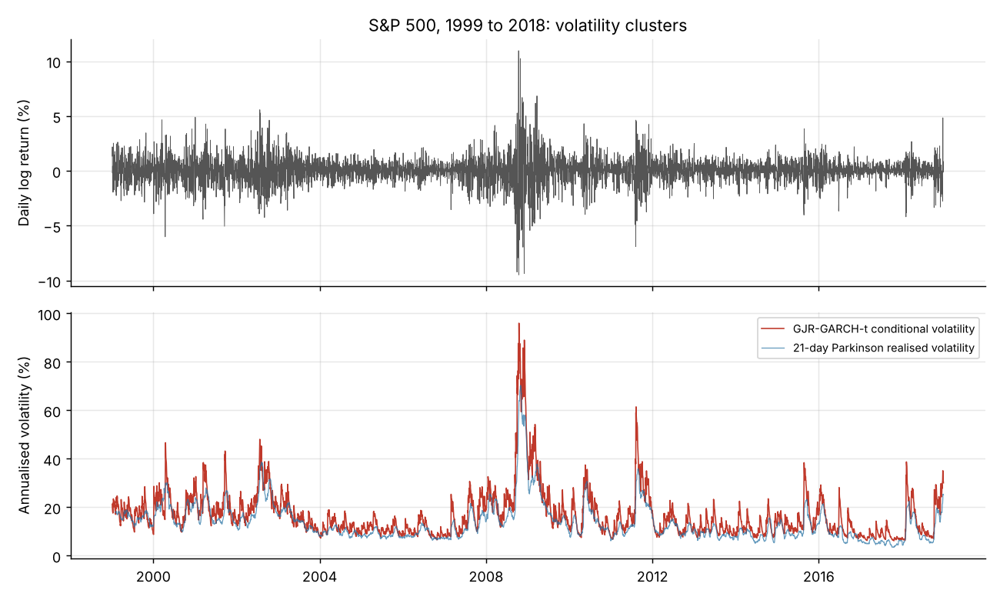
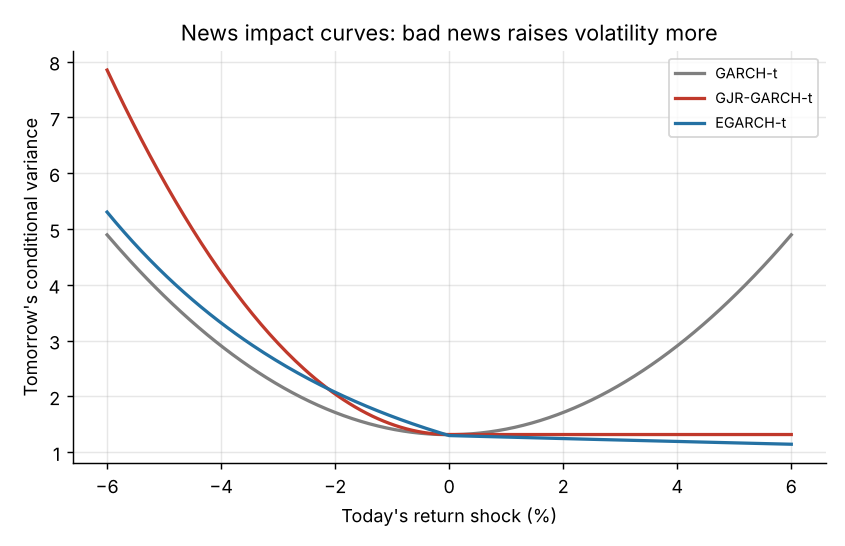
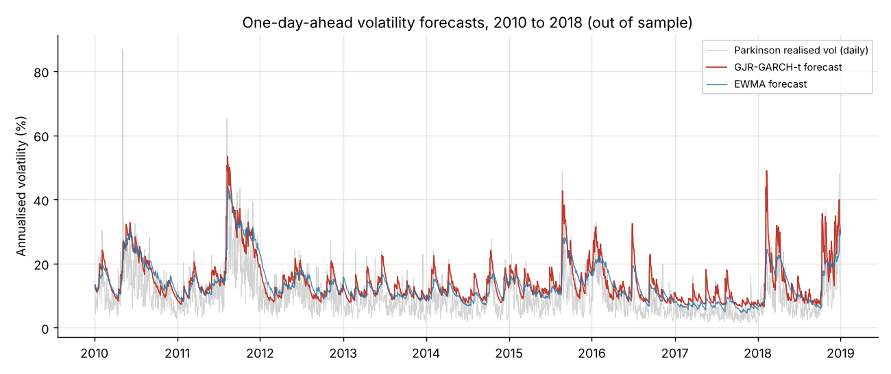
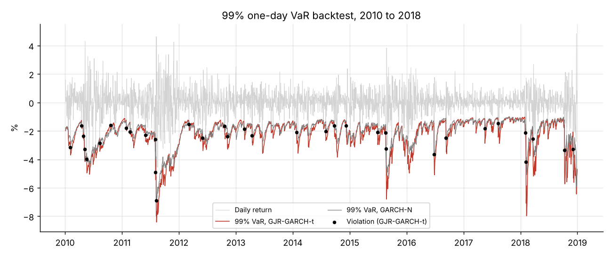

# Volatility Modelling and Forecasting with GARCH

Which volatility model best forecasts S&P 500 risk out of sample, and does modelling the
**leverage effect** (bad news raises volatility more than good news) actually pay off? Four
GARCH-family models are estimated on 20 years of daily data (1999 to 2018), then compared on 2,260
days of out-of-sample forecasts and 99% Value-at-Risk.



## 1. Stylised facts

| Statistic | Value |
|---|---|
| Daily observations | 5,030 |
| Annualised volatility | 19.1% |
| Skewness | -0.20 |
| Excess kurtosis | **8.17** (fat tails, Jarque-Bera p < 0.001) |
| Ljung-Box(10) on squared returns | p < 0.001 (**volatility clustering**) |

## 2. Estimation (full sample, Student-t errors unless stated)

| Model | α | γ (leverage) | β | ν (t dof) | Persistence | Half-life | BIC |
|---|---|---|---|---|---|---|---|
| GARCH(1,1)-Normal | 0.102 | | 0.885 | | 0.987 | 54 days | 13,917 |
| GARCH(1,1)-t | 0.100 | | 0.900 | 6.5 | 0.9996 | very long | 13,712 |
| GJR-GARCH(1,1)-t | **0.000** | **0.182** | 0.899 | 7.5 | 0.989 | 65 days | 13,548 |
| EGARCH(1,1)-t | 0.129 | **-0.154** | 0.982 | 7.3 | 0.982 | 39 days | **13,516** |

- **Fat tails matter:** switching from Normal to Student-t errors improves BIC by 205 points;
  ν ≈ 7 means extreme days are far more likely than a Gaussian implies.
- **The leverage effect is the whole story:** in the GJR model α is estimated at zero and γ at 0.18,
  i.e. *only negative returns* raise next-day volatility. EGARCH confirms it with a negative γ.
  Both asymmetric models beat symmetric GARCH by more than 160 BIC points.
- Volatility shocks are persistent: half-lives of 40 to 65 trading days (2 to 3 months).
- GJR-GARCH-t standardised residuals no longer show ARCH effects (Ljung-Box on z²: p = 0.33).



## 3. Out-of-sample forecasting, 2010 to 2018

Rolling 2,000-day window, parameters re-estimated every 20 days, one-day-ahead forecasts.
Forecasts are scored against the **Parkinson range-based variance** (from daily high and low), a much
less noisy proxy than squared returns, with the **QLIKE** loss, which is robust to proxy noise
(Patton, 2011). Diebold-Mariano tests compare each model with GARCH-Normal (negative = better).

| Model | QLIKE | DM vs GARCH-N | DM p-value | 99% VaR breaches (22.6 expected) | Kupiec p | Independence p |
|---|---|---|---|---|---|---|
| GARCH-N | 0.555 | | | 50 | 0.000 | 0.125 |
| GARCH-t | 0.554 | -0.61 | 0.540 | 39 | 0.002 | 0.032 |
| **GJR-GARCH-t** | **0.520** | **-4.88** | **0.000** | **35** | **0.016** | 0.119 |
| EGARCH-t | 0.530 | -2.83 | 0.005 | **35** | **0.016** | 0.119 |
| EWMA (RiskMetrics) | 0.526 | -2.84 | 0.005 | 55 | 0.000 | 0.054 |

- **GJR-GARCH-t is the best forecaster**, significantly better than GARCH-Normal (DM p < 0.001).
  Asymmetry, not the t distribution, drives the forecasting gain: GARCH-t alone does no better
  than GARCH-N.
- For 99% VaR, Student-t tails **cut breaches from 50 to 35**, and the asymmetric models are closest to
  the nominal 1%. Coverage is still slightly too low (Kupiec rejects at 5% but not at 1%), a known
  weakness of one-day models during sudden crashes (August 2011, February 2018).
- The industry benchmark EWMA forecasts volatility well but its Gaussian VaR fails badly (55 breaches).




## Limits and extensions

The Parkinson proxy ignores overnight gaps, so it understates true daily variance: it shifts MSE
levels but not the QLIKE ranking. Natural extensions: realised-volatility models (HAR-RV) with
intraday data, skewed-t errors, multivariate DCC-GARCH for portfolio VaR.

## Run it

```bash
pip install -r requirements.txt
python run_analysis.py      # about 1 minute; writes results/ and figures/
```

```
data/sp500_daily.csv     S&P 500 daily OHLC, 1999 to 2018 (dataset shipped with the arch package)
run_analysis.py          stylised facts, estimation, rolling forecasts, VaR backtest, charts
src/var_tests.py         Kupiec and Christoffersen VaR backtests
results/                 CSV tables
figures/                 charts
```

**Author:** Klaus KUEKOU
